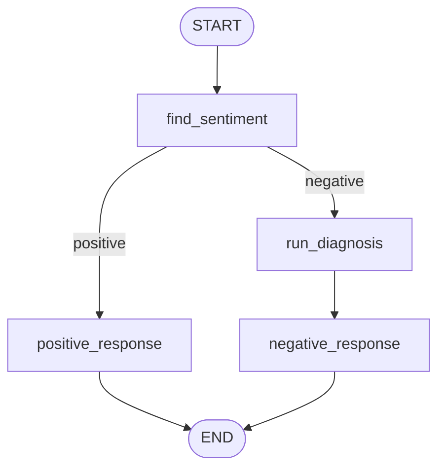

# Review Reply Sentiment

A LangGraph workflow that reads a customer review, classifies its sentiment, and routes it to the right reply. Positive reviews get a thank-you message. Negative reviews are diagnosed (issue type, tone, urgency) before an empathetic resolution message is written.

Built with **LangGraph**, **LangChain**, **Groq** (`openai/gpt-oss-20b`), and **Pydantic** structured outputs.

## Workflow



| Node | What it does |
|------|--------------|
| `find_sentiment` | Classifies the review as `positive` or `negative` |
| `positive_response` | Writes a thank-you and asks the user to post the review on the website |
| `run_diagnosis` | Extracts `issue_type`, `tone`, and `urgency` from a negative review |
| `negative_response` | Writes an empathetic resolution message using the diagnosis |

**Diagnosis schema**

| Field | Values |
|-------|--------|
| `issue_type` | `UX`, `Performance`, `Support`, `Bug`, `Other` |
| `tone` | `angry`, `frustrated`, `disappointed`, `calm` |
| `urgency` | `Low`, `Medium`, `High` |

## Setup

Requires Python 3.12+ and [uv](https://docs.astral.sh/uv/).

```bash
git clone https://github.com/Tushar-me24/review-reply-sentiment.git
cd review-reply-sentiment

uv venv
.venv\Scripts\activate        # macOS/Linux: source .venv/bin/activate
uv add -r requirments.txt
```

Create a `.env` file in the project root:

```env
GROQ_API_KEY=your_groq_api_key
```

Get a key from the [Groq Console](https://console.groq.com/).

## Usage

Open `review_reply_sentiment.ipynb`, run all cells top to bottom, then invoke the workflow:

```python
# Positive
workflow.invoke({'review': 'The interface is clean and intuitive. Great job to the design team!'})

# Negative
workflow.invoke({'review': 'The app crashes every time I upload a file, and support never replied.'})
```

Example output for a negative review:

```python
{
  'review': 'The app crashes every time I upload a file...',
  'sentiment': 'negative',
  'diagnose': {'issue_type': 'Bug', 'tone': 'frustrated', 'urgency': 'High'},
  'response': "We're sorry about the trouble you've had..."
}
```

To inspect what each node returns:

```python
for step in workflow.stream(initial_state, stream_mode='updates'):
    print(step)
```

## Project Structure

```
.
├── review_reply_sentiment.ipynb   # LangGraph workflow
├── requirments.txt                # Dependencies
├── .env                           # API key (not committed)
└── README.md
```

## Notes

- If you edit nodes or the state schema, re-run the `StateGraph` and `compile()` cells (or restart the kernel). A compiled workflow doesn't pick up later edits.
- Sentiment is binary. Add a `neutral` branch for mixed reviews.
- If `gpt-oss` on Groq gives structured-output parsing errors, use `model.with_structured_output(Schema, method="json_schema")`.

## Future Improvements

- Neutral / mixed-sentiment routing
- Escalation path for `High` urgency issues
- Batch processing of reviews from a CSV

## License

MIT
